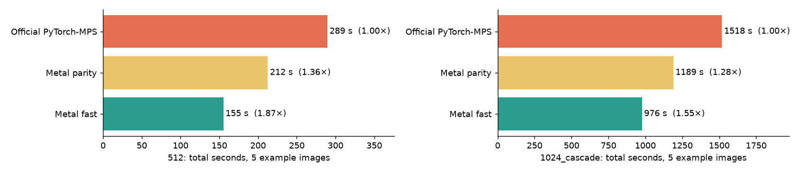
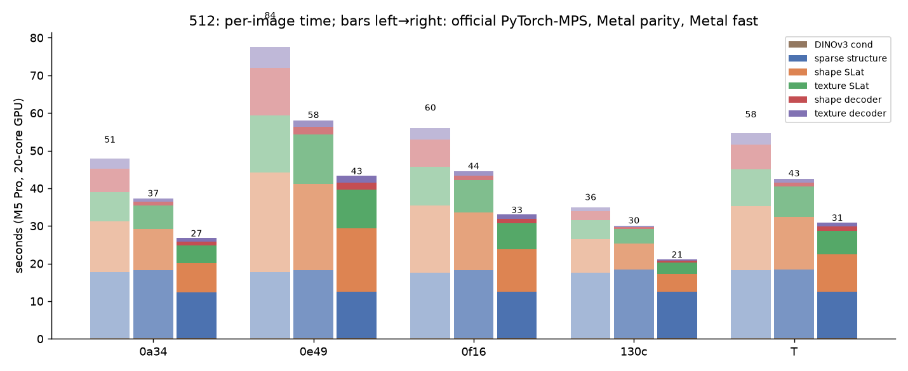
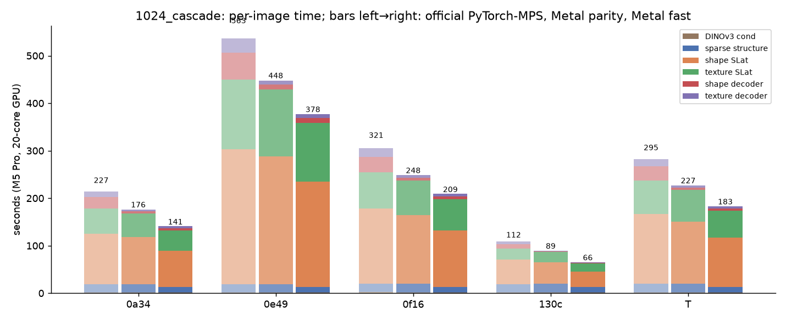
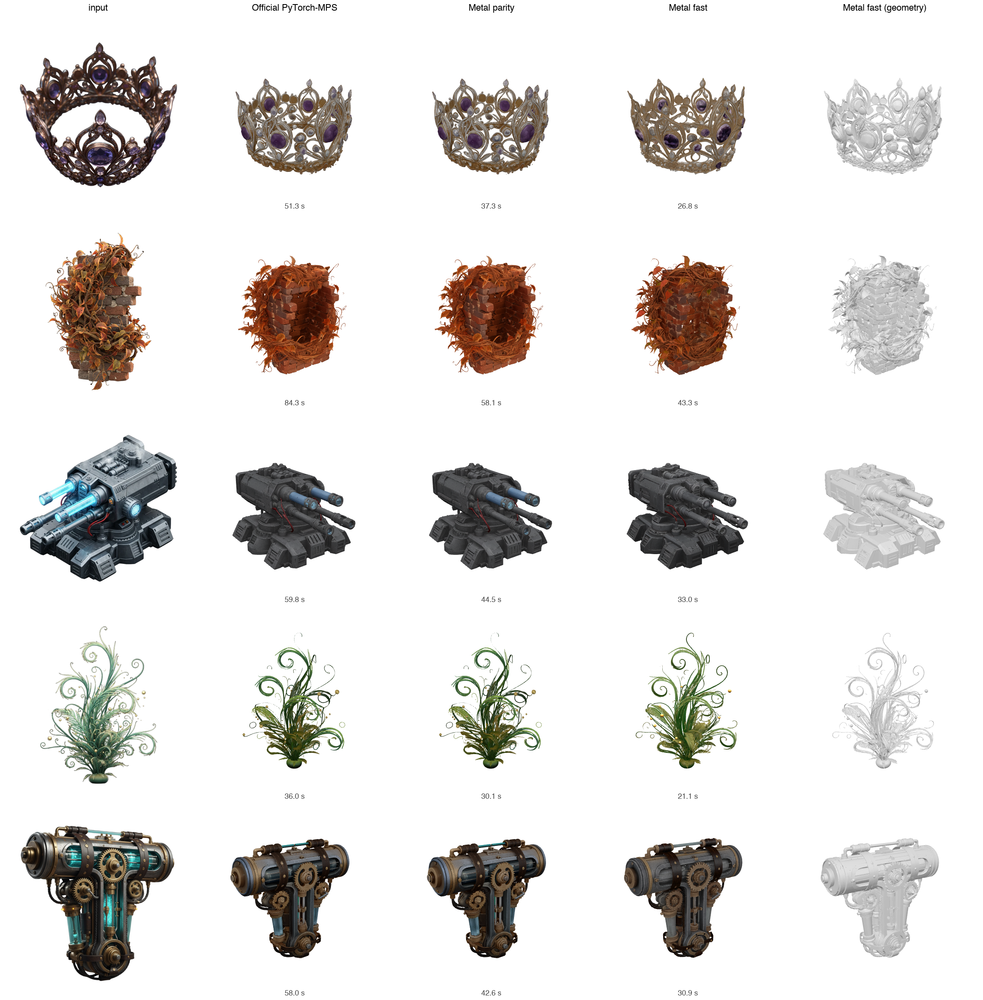
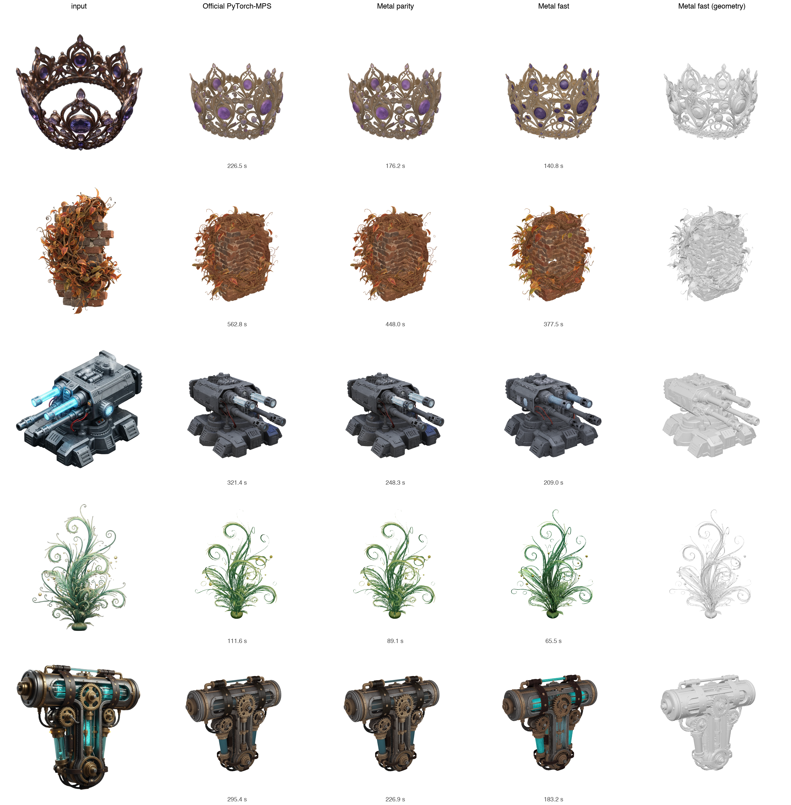
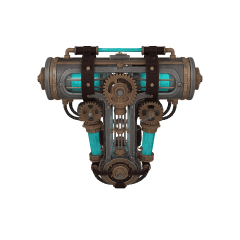

# TRELLIS.2 on Metal

Image → 3D mesh with per-vertex PBR attributes for [TRELLIS.2-4B](https://github.com/microsoft/TRELLIS.2)
(`Trellis2ImageTo3DPipeline.run`, pipeline types `512` and `1024_cascade`), as a native Objective-C++/Metal program for
Apple-silicon GPUs with no Python at runtime. Two builds from one binary:

- **parity** (`--mode parity`, default): bitwise identical to the official PyTorch-MPS pipeline, from the input image to
  the final mesh vertices, faces and voxel attributes. It loads the precompiled Metal kernel library that ships inside
  torch 2.15 and issues the same kernel dispatches and MPS/MPSGraph calls as torch does, in the same order.
- **fast** (`--mode fast`): tolerance-bounded; the flow transformers run on fused Metal kernels written for this port.
  See below.

## Results (M5 Pro, 20-core GPU, 64 GB, 5 example images, warm process, 1 warmup, seconds)

`512`:

| Image | tokens | Official PyTorch-MPS | Official `torch.compile` | Metal parity | Metal fast |
|---|---|---|---|---|---|
| 0a34 | 2867 | 51.3 | 47.6 | 37.3 | **26.8** |
| 0e49 | 5425 | 84.3 | 78.6 | 58.1 | **43.3** |
| 0f16 | 3819 | 59.8 | 56.8 | 44.5 | **33.0** |
| 130c | 1848 | 36.0 | 34.2 | 30.1 | **21.1** |
| T.png | 3530 | 58.0 | 54.8 | 42.6 | **30.9** |
| **Sum** | | 289.4 | 271.9 (1.06×) | 212.5 (1.36×) | **155.1 (1.87×)** |

`1024_cascade`:

| Image | tokens | Official PyTorch-MPS | Official `torch.compile` | Metal parity | Metal fast |
|---|---|---|---|---|---|
| 0a34 | 13360 | 226.5 | 235.1 | 176.2 | **140.8** |
| 0e49 | 27054 | 562.8 | 596.9 | 448.0 | **377.5** |
| 0f16 | 17482 | 321.4 | 348.6 | 248.3 | **209.0** |
| 130c | 7011 | 111.6 | 119.0 | 89.1 | **65.5** |
| T.png | 16362 | 295.4 | 311.4 | 226.9 | **183.2** |
| **Sum** | | 1517.7 | 1611.0 (0.94×) | 1188.5 (1.28×) | **976.1 (1.55×)** |

The fast column predates the Metal 4 GEMM described under *Metal-specific experiments*, which makes the fast build a
further 4.4% (`512`) and 3.4% (`1024_cascade`) faster in a same-session A/B.

The `torch.compile` column is the official pipeline with the flow transformers and the DINOv3 encoder wrapped in
`torch.compile(dynamic=True)` (`tools/bench_ref.py --compile`, the same wrapping as the CUDA port's baseline), with
compilation absorbed by the warmup run (117 s at `512`, 298 s at `1024_cascade`, against 51 s and 227 s eager). It is
6% faster than eager at `512`, almost all of it in the dense sparse-structure sampler (87.9 → 75.2 s), and 6% slower
at `1024_cascade` (shape SLat 747 → 808 s, texture SLat 371 → 414 s). The sparse samplers gain nothing because their
time is in the bf16 matmul and attention kernels, which compilation does not change, and the upstream sparse attention
code breaks the graph on every call (a function-local `import`). It was measured in a later session than the other
columns, so differences of a few percent may be session-to-session drift. Its meshes are not bit-identical to the
eager ones (vertex counts differ by a few percent, up to 26% on one image); their distance to eager was not measured.

Times are the whole pipeline (preprocess, DINOv3, three samplers, two decoders, mesh extraction), with model loading
excluded. Raw numbers are in `bench/*.json`. All ten parity meshes are bit-identical to the official ones.







Per stage, summed over the five images:

| Stage | Official 512 | parity 512 | fast 512 | Official 1024c | parity 1024c | fast 1024c |
|---|---|---|---|---|---|---|
| DINOv3 cond | 0.8 | 0.8 | 0.8 | 7.7 | 4.5 | 4.5 |
| sparse structure | 87.9 | 90.6 | 61.6 | 87.9 | 92.1 | 61.7 |
| shape SLat | 84.1 | 70.0 | 50.6 | 747.3 | 689.1 | 552.7 |
| texture SLat | 48.0 | 40.2 | 30.9 | 370.5 | 352.2 | 304.8 |
| shape decoder | 34.9 | 5.6 | 5.8 | 152.5 | 26.1 | 27.0 |
| texture decoder | 15.4 | 5.3 | 5.4 | 79.8 | 24.4 | 25.2 |

Where the time goes: the samplers are bf16 matmul and attention, and both sides end up in the same Apple kernels
(`MPSNDArrayMatrixMultiplication`, torch's prefill-attention kernel). On this GPU those run at about 31 and 25 TFLOPS,
and the fast build sits close to that ceiling, so the gain at 1024 (where attention is quadratic in 13k–27k tokens) is
smaller than at 512. The decoders are 3–6× faster in both builds because the sparse convolutions run as chunked
gather + matmul on the GPU with pooled buffers, while the official run goes through the pure-PyTorch fallback of
FlexGEMM/spconv on MPS.

## Outputs

Rendered with `build/render` (a small Metal rasterizer: vertex base color with simple shading, same camera):





Turntable of the Metal fast output for `T.png`:



## Fast build

| Change | Effect (T.png 512, per model call) |
|---|---|
| Residual stream in f32, one fused kernel between matmuls (residual + gate + bias + LayerNorm + modulation; bias + RMS norm + RoPE; bias + GELU) instead of 10–20 torch dispatches | dense DiT call 0.78 s → 0.52 s |
| Bias-less bf16 matmuls (bias folded into the next fused kernel); attention writes straight into the layout the output projection reads | sparse DiT call (3530 tokens) 0.64 s → 0.46 s |
| Cross-attention K/V of the image condition computed once per sampler run | part of the above |
| Unconditional branch uses the closed form of its cross attention (all keys identical → one constant row) | uncond call 0.45 s dense / 0.40 s sparse |

The fused kernels round to bf16 at the same points as the reference, so a single model call differs from parity by a
relative L2 of 4–7e-3, which is the accumulated bf16 rounding noise of the reference itself (the cond-vs-uncond
difference that guidance amplifies is 0.2–0.3). The decoders and mesh extraction are the same code in both builds.

**Tolerance gates.**
1. Sampler trajectory vs the official pipeline, compared with what the official pipeline does to itself when only its
   attention backend is switched (`PYTORCH_MPS_DISABLE_PREFILL_ATTENTION=1`, MPSGraph instead of the prefill kernel).
   Sparse-structure stage, T.png: relative L2 goes 2.1e-4 → 4.7e-2 over the 12 steps for the backend switch (3542
   tokens vs 3530) and 3.1e-4 → 7.3e-2 for the fast build (3549 tokens).
2. End-to-end mesh vs official (`tools/gates.py`: symmetric Chamfer distance over the bbox diagonal / base-color L1 on
   a 0–255 scale at matched surface samples). The parity column is an identical mesh, so it shows the sampling floor
   of the metric.

`512`:

| Image | official (alt attention) vs official | Metal parity vs official | Metal fast vs official |
|---|---|---|---|
| 0a34 | 2.7e-3 / 31.3 | 1.3e-3 / 6.6 | 2.9e-3 / 28.4 |
| 0e49 | 4.1e-3 / 16.1 | 1.8e-3 / 4.1 | 4.1e-3 / 19.7 |
| 0f16 | 3.1e-3 / 12.7 | 1.7e-3 / 3.1 | 3.8e-3 / 17.5 |
| 130c | 4.8e-3 / 24.6 | 0.9e-3 / 1.2 | 5.0e-3 / 23.9 |
| T.png | 3.1e-3 / 25.4 | 1.5e-3 / 4.1 | 3.1e-3 / 22.5 |

`1024_cascade`:

| Image | official (alt attention) vs official | Metal parity vs official | Metal fast vs official |
|---|---|---|---|
| 0a34 | 2.8e-3 / 15.0 | 1.2e-3 / 4.2 | 2.9e-3 / 27.0 |
| 0e49 | 4.2e-3 / 18.8 | 1.9e-3 / 7.3 | 4.2e-3 / 17.9 |
| 0f16 | 3.1e-3 / 28.2 | 1.7e-3 / 7.5 | 3.6e-3 / 28.1 |
| 130c | 4.9e-3 / 22.1 | 0.7e-3 / 1.5 | 5.3e-3 / 24.9 |
| T.png | 3.2e-3 / 26.9 | 1.5e-3 / 6.3 | 3.0e-3 / 28.0 |

The fast build lands at the level of the backend switch: slightly above it on some rows (geometry up to 0.5e-3 on
0f16, color 27.0 vs 15.0 on 0a34 at 1024) and below on others. The sampler is chaotic, so any rounding-level change
gives a different but equally valid sample; this is visible in the renders as small colour and detail differences
(for example the gem and tube colours).

## Metal-specific experiments (after the benchmark above)

Each idea was tried in isolation on the M5 Pro (bf16, 12 heads × 128, 4096 and 16384 tokens). One was kept.

| Idea | Result | Verdict |
|---|---|---|
| Own GEMM on Metal 4 `MetalPerformancePrimitives` `matmul2d` (64×128 output tiles, 4 simdgroups), with the MLP bias + GELU applied while the tile is still in registers | bit-identical to `MPSNDArrayMatrixMultiplication`; 31–32 vs 29–31 TFLOPS; GELU pass 2.4 ms → 1.1 ms at 16384 tokens | **kept** (fast build; `T2_GEMM=mps` or no Metal 4 falls back) |
| Tile shape of that GEMM | 64×32: 12.8 TFLOPS, 64×64: 23.7, 64×128: 32.3, 128-row tiles and 8 simdgroups slower | 64×128×4 |
| Retune torch's flash-attention kernel (query/key block, simdgroups per threadgroup, barriers) | stock {64, 32, 4} is the best at 23–25 TFLOPS; larger key blocks 4–11 | no gain |
| Flash attention on threadgroup-scope `matmul2d` (scores in threadgroup memory) | 12–13 TFLOPS vs 25 | loses |
| Attention as two MPS matmuls per head | 69 ms without the softmax vs 68 ms for the whole flash kernel, and needs N² score memory | loses |
| fp16 instead of bf16 | same throughput | no gain |

Effect of the kept change, interleaved A/B in one process (`build/gemm_ab`, sparse flow model, per call, two runs):
−4.6% / −6.3% at 16362 tokens, within noise (+3.3% / 0.0%) at 3530 tokens; outputs are identical, so the tolerance
gates above are unchanged. At 16384 tokens a block is 55% self attention, 35% matmul and 7% elementwise passes
(`build/epi_bench`), so the remaining matmul headroom is small and attention is at the ceiling of the kernel.

Whole pipeline, same session, one process per (image, backend) with the backend order flipped per image
(`tools/ab_bench.sh`, raw lines in `bench/ab/`), sum over the five images:

| Pipeline | fast, MPS matmul | fast, Metal 4 GEMM | Change |
|---|---|---|---|
| `512` | 153.3 s | 146.6 s | −4.4% (per image −2.8% to −8.1%) |
| `1024_cascade` | 1083.6 s | 1046.2 s | −3.4% (per image −2.0% to −5.1%) |

The tables at the top were measured before this change and are left as they are: absolute times drift between sessions
(the unchanged MPS path took 976.1 s for `1024_cascade` then and 1083.6 s here, and the untouched decoders moved with
it), so only same-session comparisons are meaningful at the few-percent level.

## Memory and smaller GPUs

Peak process footprint in the default mode (all models resident, buffers pooled):

| Pipeline | Official (MPS peak) | Metal parity / fast |
|---|---|---|
| 512 | 25.6 GB | 16–19 GB |
| 1024_cascade | 48.2 GB | 35–49 GB (largest image: 10.9M voxels) |

`--lowmem` loads each model only for its stage and caps the free-buffer pool (`--pool-gb`, default 1 GB in this mode).
Fast build, T.png, `512`, on the same machine:

| Flags | GPU buffer pool peak | Total |
|---|---|---|
| default | ~17 GB | 30 s |
| `--lowmem --pool-gb 4` | 6.3 GB | 29 s |
| `--lowmem --pool-gb 3` | 5.7 GB | 31 s |
| `--lowmem` (1 GB) | 3.8 GB | 35 s |
| `--lowmem --pool-gb 0.25` | 3.0 GB | 40 s |

The pool figure excludes MPS-internal scratch, so leave a few GB of headroom. That puts `512` within reach of 16 GB
machines (M1/M2/M3 base and Pro) with `--lowmem`, and plausibly 8 GB machines with `--lowmem --pool-gb 0.25` and
swap, though neither has been run on such hardware here: only the M5 Pro was available. `1024_cascade` needs a 48–64 GB
machine for large objects; `--max-tokens` lowers the cascade's token budget the same way the official pipeline does.
Nothing in the kernels is specific to a GPU family: they are plain MSL compute kernels plus MPS matmul (the Metal 4 GEMM is optional and falls back to it), and
elementwise ops over more than 2³¹ bytes are split as torch does.

## Running inference

Requires an Apple-silicon Mac, macOS 26 and the Command Line Tools (`xcode-select --install`; no Xcode or CMake, own
shaders are compiled at runtime). Python is needed once for setup, not at runtime.

**1. Checkpoints.** They are read as safetensors from `models/` (not in this repo). DINOv3 is a gated model, so accept
its licence on Hugging Face and log in (`hf auth login`) first.

```bash
pip install -U huggingface_hub
mkdir -p models
ln -s "$(hf download microsoft/TRELLIS.2-4B)" models/trellis2
ln -s "$(hf download microsoft/TRELLIS-image-large --include 'ckpts/ss_dec_conv3d_16l8_fp16.*')/ckpts" models/ss_dec
ln -s "$(hf download facebook/dinov3-vitl16-pretrain-lvd1689m config.json model.safetensors)" models/dino
```

**2. torch's Metal kernel library.** Both builds load the precompiled kernel library that ships inside the
torch 2.15 wheel (the parity build for everything, the fast build for attention and the non-transformer stages).
torch itself is not used at runtime.

```bash
python3 -m venv ref/venv && ref/venv/bin/pip install torch==2.15.0
ref/venv/bin/python tools/extract_torch_metallibs.py ref/venv/lib/python3*/site-packages/torch/lib/libtorch_cpu.dylib build/torchlibs
```

**3. Build and run.** The input image needs an alpha channel (PNG or WebP with the background already removed).

```bash
make build/t2 build/render
./build/t2 --image in.png --type 512 --mode fast --out mesh.safetensors      # fast build, about 30 s on an M5 Pro
./build/t2 --image in.png --type 1024_cascade --mode fast --out mesh.safetensors   # higher resolution, 48-64 GB machines
./build/t2 --image in.png --type 512 --mode parity --out mesh.safetensors    # bit-identical to official PyTorch-MPS
./build/t2 --image in.png --mode fast --lowmem --out mesh.safetensors        # small-memory machines, see above
./build/render --mesh mesh.safetensors --out view --views 8                  # PNG renders of the result
```

The output file holds `vertices` [V,3], `faces` [F,3], and the voxel `coords` and `attrs` (base color, metallic,
roughness, alpha) of the official `MeshWithVoxel`. Other options: `--seed N` (default 42), `--max-tokens N`,
`--pool-gb G`, `--quiet`. `T2_GEMM=mps` switches the fast build's matmul back to MPS.

**Benchmarks and checks.**

```bash
./build/t2 --image a.png --image b.png --warmup 1 --bench out.json --out dir   # timing as in tools/bench_ref.py
./build/t2 --image T.png --type 512 --ref refdump/T_512.safetensors            # prints PARITY OK / FAILED
tools/run_bench.sh 512 1024_cascade                                            # official vs parity vs fast, sequential
ref/venv/bin/python tools/bench_ref.py --compile --type 512 --images a.png --out out.json   # official under torch.compile
tools/ab_bench.sh 512 1024_cascade                                             # fast build: MPS matmul vs Metal 4 GEMM
```

The official reference (parity checks and baselines only) lives in `ref/` (not in this repo: the official TRELLIS.2
repo in `ref/TRELLIS.2`, a torch 2.15 venv, and the CUDA-only dependencies replaced by the shims in `tools/shims`). `tools/extract_torch_metallibs.py` pulls torch's
kernel library out of `libtorch_cpu.dylib`, and `tools/ref_dump.py` writes the stage-boundary dumps that
`build/parity`, `build/parity_dec` and `build/t2 --ref` compare against.

**Scope and assumptions.**
- The baseline is image → `MeshWithVoxel`. The official `to_glb` (CuMesh, nvdiffrast, FlexGEMM) is CUDA-only and does
  not run on a Mac, so GLB export is not part of either side.
- Input images need an alpha channel; background removal (rembg) is not ported.
- Bitwise parity is against torch 2.15 on this macOS version. It depends on Apple's MPS kernels, so a different OS or
  chip family may need the reference dumps regenerated before `PARITY OK` means anything there.
- Never time two GPU jobs at once on a unified-memory machine.

## Hugging Face kernels (`kernel/`)

`kernel/` packages the fast path's standalone Metal kernels for the [`kernels`](https://github.com/huggingface/kernels)
library, as a PyTorch extension that works on MPS tensors: `gemm`, `gemm_bias_gelu` (the Metal 4 MPP GEMM with fused
bias+GELU), `bias_gelu_`, `resid_ln` (residual update + layer norm) and `qprep` (q/k/v split with QK-norm and RoPE).
Hub repository: `suvadityamuk/trellis2-metal` (version 0).

```python
from kernels import get_kernel
t2 = get_kernel("suvadityamuk/trellis2-metal", version=0, trust_remote_code=True)
y = t2.gemm_bias_gelu(x, weight, bias)   # x [M,K] bf16, weight [N,K] bf16, bias [N] f32, all on MPS
```

Building and publishing needs Nix, `kernel-builder`, Xcode 26 and the Metal Toolchain
(see the [builder docs](https://github.com/huggingface/kernels/blob/main/docs/source/builder/metal.md)):

```sh
cd kernel
kernel-builder check-config
kernel-builder build-and-copy -L         # -> kernel/build/<variant>/
pytest tests                             # with LOCAL_KERNELS="suvadityamuk/trellis2-metal=$PWD"
kernel-builder build-and-upload          # publishes to the Hub
```

For quick iteration without that toolchain, `PYTHON=../ref/venv/bin/python dev/build_dev.sh ../build/kernel-dev`
builds a development-only extension (shaders compiled at runtime; never publish it), tested with
`T2_KERNEL_DEV_PATH=$PWD/../build/kernel-dev python -m pytest tests`.

## Layout

- `src/torchk/`: replay of torch-MPS kernel dispatches (elementwise, reductions, matmul, attention, conv, norms).
- `src/rt/`: tensors, buffer pool, safetensors I/O, torch-compatible RNG.
- `src/models/`: DINOv3, dense and sparse flow DiTs, sampler, sparse-structure / shape / texture decoders, mesh extraction.
- `src/fast/flow_fast.h`: the fast build's fused kernels and execution plan. `src/pipeline.h`: the driver for both builds.
- `apps/`: `t2` (pipeline), `parity*` (per-stage bitwise checks), `fast_check` (single-call error and timing),
  `render` (Metal rasterizer), `mmbench` (matmul/attention throughput); experiments: `mm_mpp`, `gemm_ab`, `epi_bench`,
  `attn_tune`, `attn_tg`, `attn_mm`.
- `tools/`: offline-only Python (reference dumps, official timing, gates, plots, visuals). `bench/`: raw timings and
  outputs. `docs/`: plots and renders.
